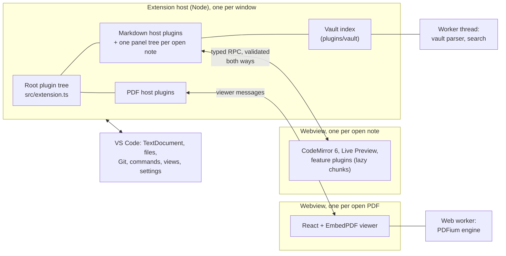
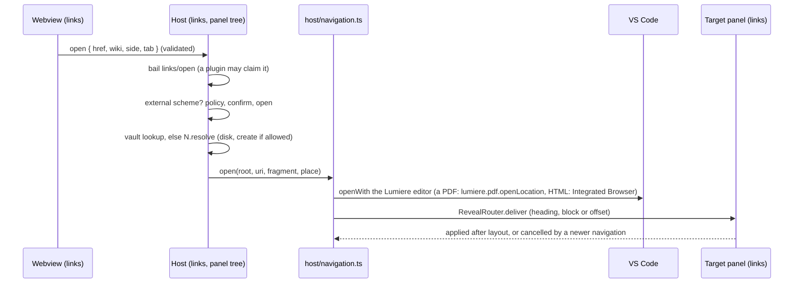

# Lumiere architecture

How `main` is built, for someone who is about to change it. One read should
leave you able to find where a feature lives, what it may talk to, and which
checks will catch a mistake. For what the product does and how it differs from
Obsidian, read the [README](../README.md) and
[packages/markdown/CAPABILITIES.md](../packages/markdown/CAPABILITIES.md)
first.

Written on 2026-11-22 against `main` at 0.1.22. Update it when the structure it
describes changes. `main` is the VS Code and Cursor extension only; the other
hosts (the desktop app, the web app, the iPad app, DeepSeek Harness) are frozen
on the `hosts-snapshot-2026-11-21` branch ([HOSTS_PLAN.md](HOSTS_PLAN.md)).

Deeper documents, by topic:

| For | Read |
| --- | --- |
| Rules for changing code, and the checks | [AGENTS.md](../AGENTS.md), [REVIEW.md](../REVIEW.md) |
| The plugin core and its lifecycle guarantees | [packages/core/README.md](../packages/core/README.md) |
| The Markdown editor: design decisions, section by section | [packages/markdown/DESIGN.md](../packages/markdown/DESIGN.md) |
| One plugin | `README.md` in `packages/markdown/src/plugins/<id>/` or `packages/pdf/src/extension/plugins/<id>/` |
| The public API, and writing a plugin as a separate extension | [packages/markdown/API.md](../packages/markdown/API.md), [packages/markdown/AGENT.md](../packages/markdown/AGENT.md) |
| The PDF reader | [packages/pdf/README.md](../packages/pdf/README.md), [packages/pdf/AGENTS.md](../packages/pdf/AGENTS.md) |
| What both products hand to agents | [packages/agents/docs/](../packages/agents/docs/) |

## 1. The system in one picture

One extension, "Lumiere: Obsidian-style Notes and PDF Reader", contains two
products that share one plugin tree:

- **Lumiere** is the Markdown editor: a VS Code custom editor
  (`lumiere.markdown.editor`) that shows each note in a CodeMirror 6 webview
  with Obsidian-style Live Preview.
- **Lumiere PDF** is a PDF reader: a custom editor (`lumiere.pdf.viewer`) whose
  webview is a React application on EmbedPDF 3 (PDFium compiled to
  WebAssembly).



Four facts explain most of the design:

1. **Everything is a plugin.** A plugin declares the services it reads and
   publishes, and the core refuses anything else (section 3). A feature that
   misbehaves is stopped on its own; the others go on.
2. **VS Code owns the text.** The webview edits a local CodeMirror copy and
   synchronizes with the `TextDocument` (section 7). Saving, undo, hot exit and
   file watching are VS Code's.
3. **The webview is untrusted.** Every message has a schema and is validated in
   both directions, and the host re-checks paths (section 13).
4. **Plugins reach VS Code only through host services.** Markdown plugins never
   import `vscode`; the host layer (`src/host`) adapts it for them (section 6).

## 2. Repository layout and layering

```text
src/extension.ts       composition root: one plugin tree for both products
packages/core          the plugin core (on Cordis). Pure.
packages/agents        what both products hand to agents. Pure.
packages/scroll        how both products read a wheel gesture (axis locking). Pure.
packages/markdown      Lumiere: plugins, webview, workers, VS Code adapters
packages/pdf           Lumiere PDF: extension plugins, portable host code, React webview
test/vscode            end-to-end tests in a real VS Code or Cursor
scripts/               build, generated contributions, third-party notices
```

"Pure" means no DOM, VS Code or Node APIs: the code runs in the extension
host, in a webview and in a unit test alike. Inside each product, `src/shared`
and `src/markdown` are pure too. Imports point one way:

```text
core, agents, scroll  <──  shared, markdown (pure)  <──  plugins  <──  host (VS Code)  <──  src/extension.ts
```

The `architecture/boundaries` lint rule in `eslint.config.mjs` enforces it, so
a bad import fails `pnpm check`, not a review:

- Pure layers (`packages/{core,agents,scroll}/src`, and `src/shared` and
  `src/markdown` of each package) cannot import `vscode`, `node:*`, or anything
  in `src/host`, `src/webview`, `src/plugins` or `src/workers`.
- A plugin may import another plugin's `api`, `manifest` or `protocol` file and
  nothing else of it.
- A plugin cannot import `src/host`, nor `src/webview` except `webview/ui`.

`pnpm build` writes `dist/extension.js` (the extension host, bundled from
`src/extension.ts`), `dist/markdown/` (webview bundles, workers, API types) and
`dist/pdf/` (the viewer, the PDF engine worker, the bridge server). The
contributions in `package.json` are generated (section 4).

## 3. The plugin core

`packages/core` (about 1,600 lines) is the API every plugin programs against.
Underneath it runs [Cordis](https://github.com/cordiverse/cordis), pinned
exactly, used as a fiber scheduler that gates on services; the core does not
use Cordis's `isolate` or `intercept`.

- **Plugin.** A `name`, an `inject` list (`required` and `optional` services), a
  `provides` list and `apply(ctx, config)`. Everything a plugin acquires in
  `apply` (listeners, editor extensions, commands, child plugins, services)
  goes through `ctx`, so it is released when the plugin stops.
- **Service.** A plain value published with `ctx.provide(name, value)`, typed by
  declaration merging on `Services`. A plugin may read only what it injects and
  publish only what it declares; anything else throws. So the dependency graph
  is a property of the definitions: `plugins/plugin-graph.ts` builds it without
  running anything.
- **Fiber.** One started plugin. It starts when every required service exists,
  restarts when one is replaced or an optional one comes or goes, and stops
  only after the plugins that depend on its services have stopped.
- **Events.** A ranked bus: `emit` (every listener), `bail` (first
  non-undefined answer wins) and `pipeline`. Listeners run in plugin rank, so a
  restarted plugin keeps its place, and a throwing listener is logged and
  skipped.

What the core adds to Cordis, and why:

| Guarantee | Why the products need it |
| --- | --- |
| Release is last-first, one at a time, and joined: a stop resolves only when every cleanup has settled | Editor extensions reconfigure CodeMirror as they are removed; overlapping releases corrupted editor state |
| An `apply` still running when its plugin stops is abandoned, and what it acquires afterwards is undone at once | Async starts (index loads, chunk fetches) would otherwise leak into a closed panel |
| Optional services | Most links between features are "use it if present" |
| Ranked, error-isolated events | Link clicks and opens are claimed by the first plugin that wants them, in a stable order |
| Ownership tree and a resource ledger | Leak tests count live resources per owner after a stop |
| Declared `inject` and `provides`, enforced | The graph is checkable statically; undeclared reads fail loudly |

The conformance suite in `packages/core/test/conformance` is the contract for
these. Run it before upgrading Cordis, whose API is not stable.

## 4. Anatomy of a Markdown plugin

A Markdown plugin lives in `packages/markdown/src/plugins/<id>/`:

| File | Holds |
| --- | --- |
| `manifest.ts` | id, title, kind (`core` or `feature`), default on or off, surfaces (`host`, `webview`), capabilities, settings schema, commands, keys, menus and views |
| `host.ts` | the extension-host half (no `vscode` import) |
| `webview.ts` | the webview half (CodeMirror extensions, DOM) |
| `protocol.ts` | the RPC between the halves: requests and notifications, each with a schema |
| `api.ts` | the types and service shapes other plugins may import |
| `README.md` | what it does, how it works, files, services, limits and differences from Obsidian |

A plugin's two halves are two `Plugin` values with the same `name`: one runs in
the extension host and one in the webview. A plugin with one surface has one
file. There are 10 core plugins (document, editor, dialect, commands,
livePreview, render, resources, vault, markers, publicApi), 34 editor features
and 14 window features (Explorer views, the quick switcher, the status bar, the
Git diff editor, the graph and the like; nearly all have no editor half).

**Where a plugin is registered.** The catalog is `plugins/catalog.ts` (which
manifests exist), `plugins/plugin-order.ts` (precedence: CodeMirror extension
order, event rank and the order in Settings, not dependencies) and the barrels
`plugins/host.ts` and `plugins/webview.ts`. A feature with an editor half also
needs a loader in `webview/features.ts` (each is a dynamic `import()`, so
Mermaid, MathJax or Vim load only when the feature is on), and a window or
panel host half is started from `host/bootstrap.ts` or `host/features.ts`.
Tests check that every catalog plugin appears exactly once in the order list.

**Generated contributions.** `package.json`'s `contributes` (commands,
keybindings, menus, views and the configuration, including each plugin's
`lumiere.markdown.plugins.<id>.enabled`) is generated from the manifests by
`pnpm contributions`, and `pnpm check` fails when it is stale. Lumiere PDF's
contributions are written by hand in `packages/pdf/contributes.json` and merged
in. Each product owns its settings prefix, `lumiere.markdown.` or
`lumiere.pdf.`.

**Switching a plugin off.** A plugin's id is both the user's unit of control
and the unit of fault isolation. `PluginSwitch` starts and stops each half as
the setting changes; a plugin that throws is stopped and reported (**Show
Plugin Status**), and the others carry on. `lumiere.markdown.preset` chooses
`obsidian` (the default) or `minimal`, which loads only the core plugins and
opens notes in Source mode.

**Lumiere PDF's plugins** (`packages/pdf/src/extension/plugins/<id>/`, listed
in `catalog.ts`) use the same core but are simpler: a `plugin.ts` and a manifest
each, and most inject the `pdfPanels` service that the `pdf` plugin provides.
There are 13: `pdf`, `pdfBacklinks`, `pdfAnnotations`, `pdfHistory`,
`pdfToolbar`, `pdfOutline`, `pdfBookmarks`, `pdfRegions`, `pdfLookUp`, `pdfZen`,
`pdfSettings`, `agentBridge` and `ideContext`. The viewer itself is one React application, not
plugin halves.

## 5. Plugin trees at run time

A window holds several trees. Services do not flow between trees by
themselves; the code that creates a tree hands them over.

```text
Root (src/extension.ts, createRoot)
│  provides: extensionContext, outputChannel, noteSelections, pdfOutlines
│
├─ PDF plugins (startPdf in packages/pdf)
│
└─ Markdown (startMarkdown -> host/bootstrap.ts)
   ├─ host services (the VS Code adapters, section 6), vaults, documents
   ├─ core host plugins: editor host, dialect, commands, livePreview, markers, ...
   ├─ window features (Explorer views, quick switcher, link updates, graph, ...);
   │     15 of them wait for the first editor's `editor/ready`
   │     (emitted when its webview reports `initialized`)
   │
   └─ one panel tree per open note (plugins/editor/panel.ts, createRoot)
        re-provided: host services, vaults, pdfOutlines
        vaultHost (this note's vault), resourcesHost
        critical panel hosts: links, tasks, properties, folding, tags, ...
        deferred panel hosts: gitGutter, gitBlame, suggest, search, lookUp
              (started once the answer to the webview's `ready` is built)

Webview (one per panel, its own JavaScript realm; webview/bootstrap.ts, createRoot)
   core: document, dialect, editor (the CodeMirror view), commands, markers,
         then resources, render and livePreview in the obsidian preset
   features: the ones the host lists as on for this note, each a lazy chunk
```

Points that matter when changing code:

- **Panel trees are separate roots.** The core has no scoping, so each panel gets
  its own root, and the code that creates it hands over what its plugins need:
  `plugins/editor/host.ts` re-provides `vaults` and `pdfOutlines`, and
  `configure` in `host/bootstrap.ts` re-provides the host services. A new root
  service that panel plugins need must be handed over there, and added to
  `ROOT_SERVICES` in `plugins/plugin-graph.ts`.
- **Critical and deferred.** Panel hosts that must answer before the first paint
  start with the panel; the ones that only answer later requests start once the
  answer to the webview's `ready` is built (`editor/session-ready`), so they
  never delay first paint (`host/features.ts`).
- **Optional services restart their consumers.** When an optional service
  appears after its consumer has started, the consumer restarts. For a panel's
  editor host that would close the editor, so `noteSelections` and `pdfOutlines`
  are provided on the root before either product starts.
- **External plugins** (other VS Code extensions that use API v1) run in an
  isolated root of their own (`host/api/external-context.ts`) and contribute
  data only: markers, actions, link handlers and code block renderers. No
  outside code runs in a webview.

## 6. Host services: the seam to VS Code

Markdown plugins inject host services, declared in `packages/markdown/src/shared/host`
and implemented once, over VS Code's API, in `packages/markdown/src/host/services`:

| Service | What plugins get |
| --- | --- |
| `hostDocuments` | open, read and edit text documents; optional completions for VS Code's text editor |
| `hostCommands` | run and register commands |
| `clipboard`, `dialogs` | clipboard; pickers, input boxes, messages |
| `views` | tree views and panels (outline, backlinks, tags, graph) |
| `activeEditor` | the focused editor and its selection |
| `settings` | per-note settings (`forNote`), and `prepare(uri)` |
| `workspace` | folders, workspace trust, files |
| `storage` | workspace storage (index snapshots, recents) |
| `extensions` | other extensions (API v1) |
| `navigation` | open a link target, create notes, native document links |
| `customEditors` | the custom editor registration |
| `agentHost`, `git`, `diffViews` | agent chats, Git data, diff editors |

Inject the narrowest service that does the job. The seam keeps `vscode` out of
the plugins and lets unit tests replace it: `fakeHost(overrides)` in
`packages/markdown/test/support/vscode-fake.ts`. A plugin whose needs the host
does not meet (`workbench`, `git`, `panels` in its manifest) stays off and its
settings are hidden. A Markdown fix belongs in the plugin, never as a special
case in `src/host`.

## 7. The document: who owns the text

VS Code's `TextDocument` owns the text, saving and undo. A webview never writes
a file.

- The host keeps one **session** per document (`plugins/document/`): a version
  number and a log of recent revisions.
- A webview sends its changes as versioned updates with its client id
  (`@codemirror/collab` style). The host applies them to the `TextDocument` as
  a `WorkspaceEdit`, assigns the next version and broadcasts the accepted
  changes to every panel of that document. One file can be open in several
  panels, so editors are tracked per panel, never by path.
- Changes from elsewhere (another editor, Git, an agent writing the file) arrive
  as `TextDocument` changes and are broadcast the same way.
- A panel that missed a broadcast asks for the revisions it lacks (`catchUp`) and
  replays them, rebasing its unsent edits. A push that times out or an edit the
  workbench refuses is retried with backoff; any other failure makes the panel
  read-only so no more typing is lost.
- Undo and redo are VS Code's: the webview forwards the commands, the host runs
  them on the document, and the result comes back as an ordinary change. A
  panel keeps no second undo stack.
- Save is VS Code's. A note open in Lumiere is also saved two seconds after its
  last edit (`lumiere.markdown.editor.autosave`), through the same path as the
  Save command.

The same note can also be open in VS Code's text editor. **Toggle Text Editor**
(Ctrl/Cmd+E, in both directions) and **Open as Text** switch between the two over
one `TextDocument`. When a note lands in a native text or Markdown tab (Cursor
has its own Markdown editor, and tools can open the text editor), `host/reclaim.ts`
brings it back to Lumiere if the workspace uses Lumiere for Markdown (in `auto`
mode, always in Cursor), unless the user chose the text editor.

## 8. Parsing and rendering

**One parser.** The `dialect` plugin extends CodeMirror's Lezer Markdown with
Obsidian's syntax (wikilinks, embeds, callouts, highlights, comments, math,
tags, block ids, footnotes). The editor, the metadata collector in the vault
index and the HTML renderer all use it, so they agree on what a link or a
heading is. Plugins change presentation and interaction, never the grammar. The
pure parts live in `packages/markdown/src/markdown`.

**Live Preview.** The `livePreview` plugin does not parse. It reads CodeMirror's
own syntax tree (and pushes the parse ahead of the viewport when a large note
needs more of it) and turns it into decorations:

- *Block renderers* (`livePreview.block(renderer)`) replace a node's range with a
  widget: tables, callouts, math, diagrams, properties, embeds, code blocks.
  Block widgets live in a CodeMirror state field, because only fields can change
  vertical layout, and keep estimated heights so a remount does not jump.
- *Inline renderers* (`livePreview.inline(renderer)`) hide, mark or replace
  inline syntax: emphasis, links, tags, footnote references, images.
- Feature plugins register their renderers through `ctx`, in catalog rank order;
  turning a plugin off removes its renderers and its widgets fall back to source.
  The engine itself draws basic syntax (emphasis, headings, quotes, list bullets).
- **The reveal rule.** One function decides whether a construct shows its source:
  true when any selection range touches it. The exceptions follow Obsidian
  (display math reveals only while the editor has focus, the find bar's current
  match reveals) or a recorded decision (an image reveals its source and keeps
  the image after it). Reveal rules and their evidence are in
  `packages/markdown/docs/OBSIDIAN_REVEAL_RULES.md`.
- **Modes.** Live Preview or Source mode, per view
  (`lumiere.markdown.editor.defaultMode`, **Toggle Live Preview/Source Mode**).
  There is no Reading view.

**HTML rendering.** The `render` plugin serves everything that is HTML rather
than a live editor decoration: embedded notes, hover previews and callout
bodies. Each render is a pass: preprocess, render with the dialect's renderer,
sanitize with DOMPurify, let plugins claim fences (`render/fence`, a `bail`
event, which is how Mermaid diagrams and `query` blocks are drawn), post-process,
and measure. Passes own their
cleanup, so closing a panel disposes them. Scripts, forms, objects and `srcdoc`
are removed, and remote content needs a trusted workspace.

## 9. The vault and its index

A **vault** is the folder that contains a `.obsidian` entry (`vault.rootMarkers`)
or else the workspace folder holding the note. `vaults.forDocument(uri)` creates
its indexer on first use, and `vaults.locate(uri)` gives a note's vault and path.

- **Indexing** runs in a worker thread (`workers/vault.ts`; client in
  `host/vault-parser.ts`). It parses each note's headings, blocks, links, embeds,
  tags, front matter and aliases with the same parser the editor uses, only for
  notes whose time or size changed. The index is saved in workspace storage in
  128 shards, so the next window starts with links already resolved. Open notes
  are indexed from their unsaved text.
- **The index** (`plugins/vault/api.ts`, `VaultIndex`) answers files, metadata,
  resolved and unresolved links, backlinks and change events. Link suggestions,
  backlinks, outgoing links, the outline, the graph, link updates, search and the
  quick switcher read it instead of scanning the disk. Opening a note does not
  wait for indexing.
- **Link resolution** (`plugins/vault/resolve.ts`) follows Obsidian's
  `getLinkpathDest`: case-insensitive, `.md` optional, `./` and `../` from the
  note's folder, a leading `/` from the vault root, other paths from the root. A
  name that matches several files prefers those under the source note's folder.
  Aliases are suggested but are not link destinations, as in Obsidian.
  A click or preview that the index cannot answer (a file in a hidden folder)
  looks on disk, in the one order `shared/link-location.ts` defines.
- **Limits.** 50,000 notes and 50,000 other files per vault, hidden folders and
  `node_modules` skipped, and in VS Code what `files.exclude` hides is not walked.
- **Vault settings.** The `obsidianCompat` plugin reads the vault's
  `.obsidian/app.json`, `types.json` and `templates.json` into Lumiere's
  settings (a value set in VS Code wins) and never writes them. `resources`
  gives embeds and previews contained access to files: a path outside the vault
  or an escaping symlink is refused.

## 10. Links, navigation and reveal



- The webview's `links` plugin turns a click or key into an `open` request
  (`plugins/links/protocol.ts`). Which gesture follows a link is a product
  decision: a plain click on a rendered link reveals its source, Ctrl/Cmd-click
  opens a new tab, Alt+Enter follows at the caret.
- The host's `links` plugin first offers the request to listeners of the
  `links/open` bail event, then applies the scheme policy (script, data,
  command and file schemes are refused, other application schemes ask first),
  then resolves the target and calls `navigation.open`.
- `navigation.open` (`host/navigation.ts`) checks containment, opens a note with
  `vscode.openWith`, a PDF through `lumiere.pdf.openLocation` (Lumiere PDF's
  command, at `#page=N`), an HTML file in VS Code's Integrated Browser where the
  window has one, and anything else with `vscode.open`.
- **Reveal.** Moving to a heading, block or offset in the opened note goes
  through `RevealRouter` (`host/reveal-router.ts`). Each navigation begins an
  intent with a cancel token, so a newer navigation cancels an older one. The
  destination editor is chosen by its panel id, never by file path. Every jump
  into a note (a link, a Markdown Outline row, **Go to Heading…**, a Backlinks
  entry, a Search match) uses it, and the webview acknowledges after layout. With
  the `links` plugin off for a note, those jumps open the note without moving in
  it.
- **Back and Forward** inside a note (`editor` plugin, `jump-history`) are per
  panel, in memory, for deliberate jumps. Cross-file Back is VS Code's.
- **VS Code's own text editor.** `host/source-links.ts` gives inline Markdown
  links there a document link with a signed ticket (checked against the clicked
  text, the document version and containment), and the `suggest` plugin offers
  `[[` completions through `hostDocuments`. Wikilinks in the text editor are not
  followed.

## 11. The PDF reader

```text
extension host                                       webview (React, EmbedPDF + PDFium wasm)
  pdf plugin (pdfPanels) --- shared/messages.ts --->   viewer.tsx, pages, selection, search,
  pdfOutline, pdfHistory, pdfToolbar, ...              outline, backlink overlays, annotations
  pdfBacklinks (scans notes, matches quotes)           engine in a web worker (engine-host.ts)
  pdfAnnotations, pdfRegions, agentBridge, ...
  outlines/, pdf-text/ (PDFium in Node, on demand)
```

- **Split.** `packages/pdf/src/extension` holds the VS Code plugins;
  `src/host` is portable viewer logic with no `vscode` import; `src/shared` is
  pure; `src/webview` is the React viewer. The extension plugins import `vscode`
  directly, and almost all of them inject the `pdfPanels` service. Host and
  viewer exchange the messages in `shared/messages.ts`, which the host parses
  with hand-written validators.
- **EmbedPDF** (`@embedpdf/*`, pinned exactly) runs the viewer. The plugins
  assembled in `webview/plugins.ts` are `stage` (one surface that lays out,
  scrolls and zooms the pages in single, spread, paged and horizontal flows),
  `render` (a quick picture of the whole page, then sharp tiles), `interaction`,
  `selection`, `search`, `history`, `annotation`, `link` and `outline`, plus
  Lumiere's own `lumiere-text`, which gives the other layers each page's text
  and glyph boxes.
- **One PDFium engine per viewer page**, in a web worker, with the main thread
  as a fallback when the worker fails or does not answer in time. An engine that
  dies after the PDF opened is shown as stopped, with Reload.
  The host reads a PDF once per change for all its panes and opens files up to
  512 MB. The extension host has a second PDFium (`dist/pdf/outline-engine.js`)
  that reads bookmarks for `[[paper.pdf#` suggestions and, for the agent
  bridge's text tools (`get_pdf_page_text`, `find_in_pdf`, `locate_pdf_quote`,
  `list_pdf_annotations`), the text of PDFs that need not be open; it starts on
  first use.
  A Markdown note's PDF embed runs the engine in the editor webview's own thread.
- **Links into PDFs** are plain fragments (`#page=N`, `#:~:text=`), so Obsidian and
  browsers read them too. `pdfBacklinks` scans the workspace's Markdown notes
  from the first PDF opened in the window, matches `#:~:text=` quotes against the
  page text, and pushes overlays to open viewers. It is a cache and is never
  written to disk. It does not use Markdown's vault index.
- **Annotations stay outside the PDF.** They are saved as
  `{ "version": 2, "bundle": … }` files named by the PDF's SHA-256, merged by
  annotation, three-way, so two panes or windows of one PDF do not overwrite
  each other. The PDF's bytes change only when the user runs **Save Annotations
  into This PDF**, which refuses protected folders.
- **Shared with Markdown** (section 12): the `noteSelections` and `pdfOutlines`
  root services. Neither product imports the other.

## 12. Agents

`packages/agents` (pure) defines, once, what both products hand to agents:

- **The reference and quote** Copy link to this writes: `@notes/a.md#12-18` or
  `@papers/a.pdf#page=3`, a blank line, the passage quoted with `> `
  ([agent-handoff-format.md](../packages/agents/docs/agent-handoff-format.md)).
  Its wording stays compatible with LLM Wiki.
- **The IDE context packet** (the active note or PDF, the selection, open tabs,
  diagnostics), scrubbed and truncated before it is rendered.

Each product has plugins that deliver them. In Markdown: `agentBridge` (Copy link
to this, with `copyLinkForAgent.target` choosing Cursor's chat, VS Code's chat,
Claude Code, Codex or only the clipboard), `ideContext` (Copy and Send IDE
Context), `bridge` (a versioned JSON selection envelope) and `cursorBridge`
(Cmd/Ctrl+L and K in Cursor). In Lumiere PDF: `agentBridge` (Copy link to this,
which only copies), `ideContext`, and an opt-in MCP server
(`lumiere.pdf.agentBridge.enabled`, off by default: 127.0.0.1 only, a random
port, a bearer token in a header) whose tools return the PDF and note selections,
open a PDF location, describe a PDF and the notes that cite it, and return the
IDE context (where the user is in notes and PDFs). A tool's file argument must
be inside the workspace. Cursor starts the stdio shim as its MCP server; VS
Code registers the HTTP endpoint. The two products meet in `noteSelections`:
the root provides it from Markdown's public API so the PDF's bridge can report a
note's selection and the active note.

## 13. Security boundaries

- **Webviews are untrusted.** Markdown's RPC validates every request and
  notification against a schema in both directions (`shared/rpc/endpoint.ts`); the
  host re-checks paths and containment, symlinks included, before it opens,
  creates or writes anything. The PDF host parses every viewer message.
- **Page policy.** A note's page has a Content Security Policy with `default-src
  'none'` and nonce-based scripts, and allows frames and remote images and media
  only in a trusted workspace.
- **Link schemes.** See section 10.
- **Workspace trust.** Remote content and external code block processors are off
  in Restricted Mode; the settings that start a server or choose a folder are
  restricted configurations (`package.json` `capabilities`).
- **Vault code.** Nothing in a vault runs: there is no Obsidian community plugin
  runtime.
- **Native links** in VS Code's text editor carry a signed ticket (section 10).

## 14. Opening a note

The path from "open `Note.md`" to an editable note, and where its time goes:

1. VS Code activates the extension (once per window) and resolves the custom
   editor. **Use Lumiere for Markdown in This Workspace** associates `*.md` with
   `lumiere.markdown.editor`, so VS Code hands the note straight to Lumiere.
2. The editor host creates the panel tree, finds the note's vault (indexed on
   first use, or loaded from its snapshot) and starts the critical panel hosts.
3. The host builds the page's HTML with the note's first screen already in it:
   inert, escaped HTML under the editor's own classes and gutters
   (`firstPaintSnapshot`, on by default). The editor entry loads by `import()` from
   a nonce'd inline script, and the first view's feature chunks are listed as
   `<link rel="modulepreload">`.
4. The webview starts its core plugins and sends `ready`. The host answers with
   the text, version, settings and the list of active features, then starts the
   deferred panel hosts.
5. The webview builds the CodeMirror state, runs the first Live Preview pass and
   replaces the snapshot without moving it; feature phases start a task after
   that paint.

Opening does not wait for vault indexing, and feature code is fetched lazily, so
by design neither the vault's size nor the number of plugins sits on the path to
the first paint. `pnpm test:quality` guards it with budgets (section 15).

## 15. Testing layers and the merge gate

| Layer | Command | What it proves |
| --- | --- | --- |
| Unit | `pnpm test` | Pure logic, plugins against `fakeHost`, the core's conformance suite, lint-rule pins, parity tables. Node's test runner via `tsx`, package by package |
| Browser | `pnpm test:browser` | Each product's webview in Chromium with a fake host (Playwright): rendering, selection, keys, layout |
| Quality | `pnpm test:quality` | Scroll smoothness, first paint and large-vault budgets, in `packages/markdown/test/quality/budgets.ts` |
| Real VS Code | `pnpm test:vscode` | The built extension in a real, isolated VS Code window (or Cursor, with `VSCODE_EXECUTABLE`), driven over CDP: native editors, the palette, settings, clipboard |

`pnpm check` is not a test layer but the first gate: Prettier on code (Markdown
documents are not formatted by it), ESLint with the boundary and size rules,
type-checking of every project, the unit tests and `pnpm contributions --check`.
`pnpm check:full` runs everything.

New automated coverage is unit tests unless the owner approves a browser or
native regression ([AGENTS.md](../AGENTS.md)). The real-VS Code specs do not run in
GitHub Actions: they were flaky under load, and Cursor cannot run there.

**Merge gate.** A pull request merges only when CI's `check`, `browser` and
`quality` jobs pass; CI also runs the unit tests on Windows, packages the VSIX and
scans for secrets. A change to editor integration (anything importing `vscode`,
the webview's HTML and resource loading, or `package.json` contributions) also
needs `pnpm test:vscode`. Budgets in `budgets.ts` are raised only with the
owner's approval and the measurement that shows why; a timing check that fails
once and then passes is reported as flaky and rerun.

## 16. Where to change what

| To change | Go to |
| --- | --- |
| How a note edits, renders or links | the owning plugin in `packages/markdown/src/plugins/<id>/`, never `src/host` |
| A command, key, menu, view or setting | the plugin's `manifest.ts`, then `pnpm contributions` |
| What a plugin reads from VS Code | a host service in `src/shared/host`, implemented in `src/host/services` |
| Link resolution or the index | `plugins/vault`, `shared/link-location.ts` |
| Opening a link, jumping to a heading | `plugins/links`, `host/navigation.ts`, `host/reveal-router.ts` |
| The Markdown grammar | `plugins/dialect`, `src/markdown` |
| The text a note shares with VS Code | `plugins/document` |
| The PDF viewer | `packages/pdf/src/webview`; host side in `src/extension/plugins/pdf` |
| What agents receive | `packages/agents`, then each product's `agentBridge` |
| Which plugin trees start, and in what order | `src/extension.ts`, `host/bootstrap.ts`, `plugins/plugin-order.ts` |

## 17. Known rough edges

- **Registration is spread over several files** (section 4), so adding a plugin
  touches more than its own folder.
- **Two module-level back-channels**, `shared/vim-hooks.ts` and
  `shared/completion-hooks.ts`, link plugins that could use optional services.
- **One import cycle:** `livePreview` reads a CodeMirror state field exported by
  `links/api`, and `links` registers a renderer through `livePreview/api`.
- **The PDF extension sits outside the host-service seam.** Its plugins import
  `vscode`, and its backlink index scans notes itself rather than reading
  Markdown's vault index, so the two apply their path rules separately.
- **Both products name a plugin `agentBridge` and a plugin `ideContext`**, and both
  run on the same root.
- **VS Code's text editor has `[[` suggestions** but no wikilink following,
  hover or unresolved marks.
